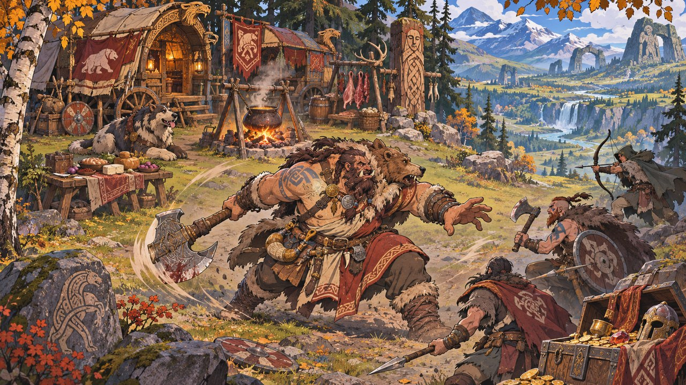
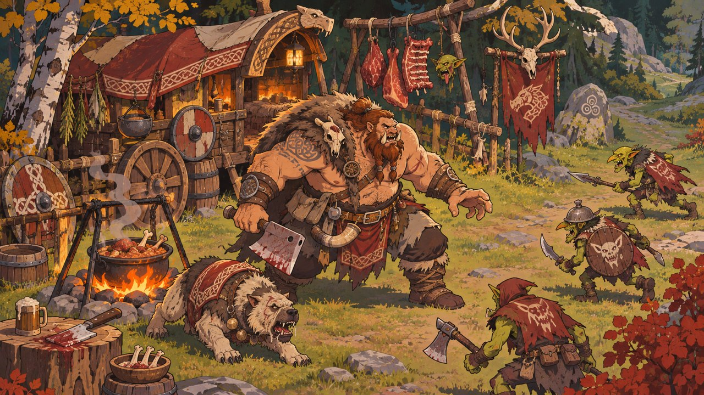
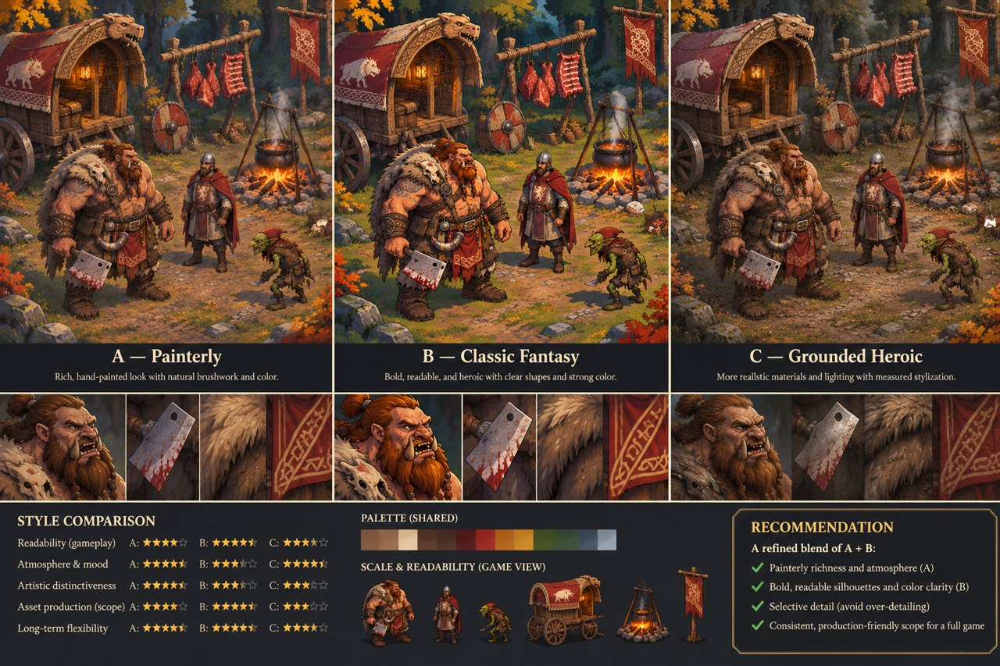
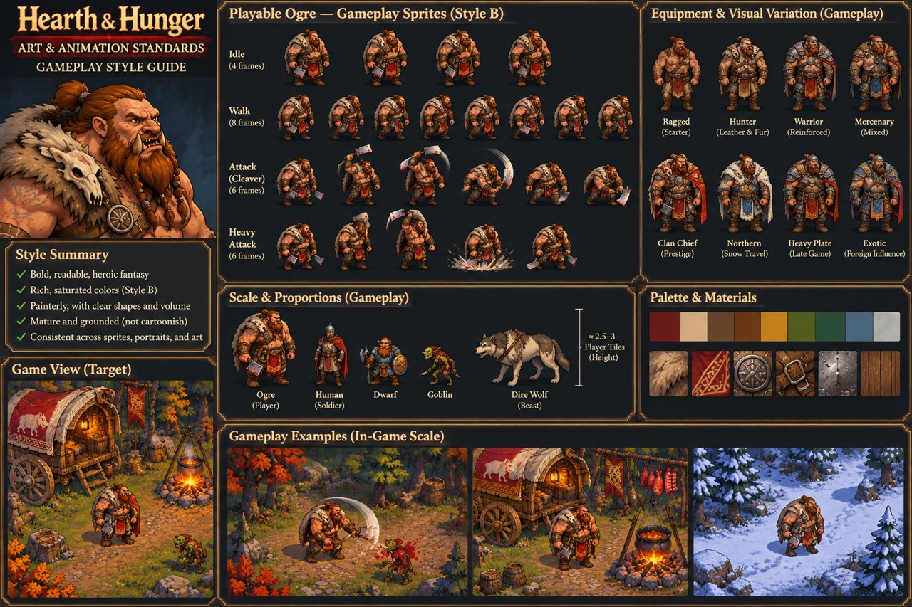
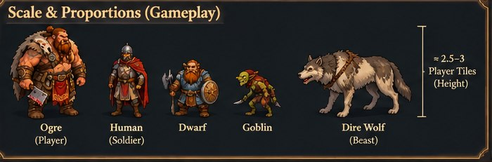
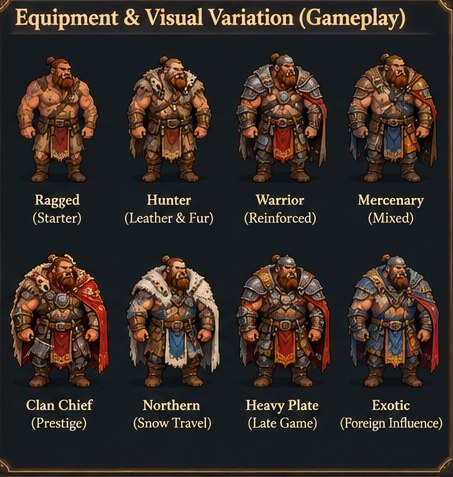
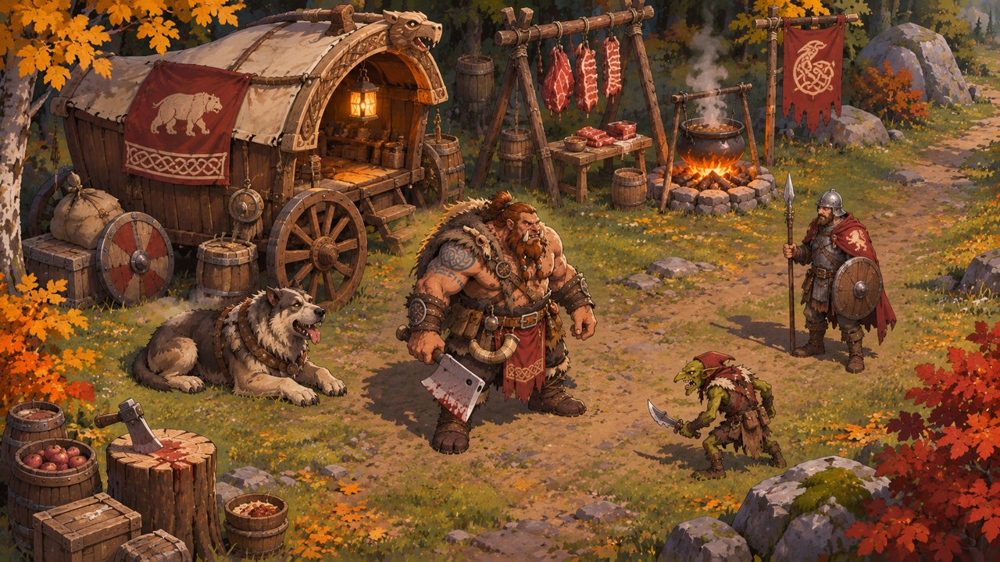

# Hearth and Hunger — Art & Animation Bible

Version 1.0 • 25 November 2026

Version 1.0  •  25 November 2026  •  Approved direction; implementation unverified

*R01 • Preferred mood illustration. Approved for adventurous atmosphere, rich color and cultural identity; too detailed for a literal sprite target.*

A mature, colorful, hand-painted Ogre action RPG. The adventurous spirit of Conan the Barbarian, the creatures and cultural richness of European mythology, and the colorful visual variety of classic Warcraft.

Use this document to guide art production, not to certify work already complete. The approved visual direction is distinct from the provisional technical settings and the gameplay tests that must still pass.

## How to use this bible

Read the reference pages, then apply the standards and acceptance gates. Preserve the shared Godot gameplay core and existing useful assets. Do not scale the art catalogue until a small, convincing playable slice has passed review.

# Visual north star

Classic heroic fantasy colors, mature forms, painterly depth, and strong silhouettes. Detail is intentional, not maximal.

*R02 • Preferred forest-camp illustration. Reference for warm colors, material separation, carved wagons, pelts, and everyday Ogre life; not a literal runtime scene.*

*R03 • Style comparison: option B (Classic Fantasy) is preferred, especially its colors. The printed ratings and recommendation are illustrative, not binding.*

Do not copy the tusks, dense ornamentation, or zoom level literally. Retain bold color and readable shape language; soften overly heavy outlines and simplify small textures. Avoid Banner Saga-like flat/angular treatment where it feels like a drawing rather than a physical world.

# Sprite and illustration standards

One coherent art identity, three levels of detail. A sprite is not a miniature cutscene painting.

*R04 • Provisional approved gameplay look board: color, equipment, character proportions and setting. Animation rows, printed tile heights and frame counts are not acceptance evidence. The lower tusks and idle pose still need correction.*

| Asset class | Art standard |
| --- | --- |
| Concept / mood | Rich, exploratory paintings; establish design, atmosphere and cultural motifs. |
| Narrative art / portraits | Detailed, mature illustration with convincing anatomy, light and materials. Preserve character continuity. |
| Runtime sprites | Simplified volumes, broad light/shadow shapes, clear equipment and strong silhouettes at gameplay zoom. No flat paper-doll look. |
| World assets | Separate modular objects with common perspective, light direction, scale and ground contact. Use selective detail to distinguish materials. |

Do not confuse saturated colors with childish art or adult fantasy with muddy darkness. Distinct palettes are welcome across regions; keep visual hierarchy and material readability consistent.

# Anatomy, customization & scale

The Ogre is an enormous, recognizably separate humanoid species — almost a bear-man, not a literal anthropomorphic bear.

*R05 • Extract from R04: relative silhouette and species identity. Use as a visual cue, not a dimensioned production sheet.*

## Species and player identity

- Use a Thor-like mythological strongman foundation: immense shoulders, thick neck and torso, huge hands, strong legs, powerful jaw and ursine facial proportions. Avoid a bear head, paws or full fur covering.

- Prominent upper canines, not large lower tusks. Expressions can be dignified, friendly, fierce or thoughtful; avoid constant snarls, grotesque caricature or foolish faces.

- Male protagonist; the player chooses name, background, clan name, face, skin tone, hair and beard, hair/eye color, scars, tattoos or war paint, and clan colors/heraldry. Provide an animated live preview. Target 8–12 face presets provisionally.

- Use one stable gameplay body template initially; no body sliders or compulsory age/size animation variants. Ogres grow with age in lore, but visible progression comes through equipment and customization. Female NPCs should remain recognizably Ogre and can be attractive and feminine.

## Camera and footprint

| Species | Relative footprint cue | 1080p screen height* |
| --- | --- | --- |
| Goblin / gnome | 1 conceptual square | 35–50 px |
| Human / Orc | 2 conceptual squares | 60–80 px (human) |
| Ogre (~10 ft) | 2 × 2 conceptual squares | 100–130 px |
| Large troll | Larger than Ogre | 150–200 px |

*Provisional screen-space targets at default zoom, not asset resolutions or grid-based movement. Use a fixed elevated three-quarter view; balanced-to-wide (B/A), adjustable zoom, and enough battlefield awareness. Test terrain projection, collision, doorway size and character readability together.

# Movement and animation

Relaxed, dignified movement in ordinary life; predatory, aggressive, responsive body language in combat.

## Core locomotion contract

WASD movement and mouse aiming. Exploration faces the direction of travel; combat faces the cursor/target and supports advancing, strafing and retreating. Eight-direction movement is the intended end state, but validate a representative subset first. No stamina gate, compulsory Ferocity meter, sluggish turns or artificial delays to make the Ogre feel heavy.

| Motion | Acceptance requirement |
| --- | --- |
| Idle / ready | Subtle breathing, believable weapon grip and purposeful resting or guarded stance. Distinct relaxed and combat idles. |
| Walk / run | Alternating left/right steps, planted feet, natural hips and shoulder counter-rotation. No sliding, single-leg shuffle, or bouncing caricature. |
| Direction changes | Stable proportions, feet, anchor and equipment placement. Turning should not pop or resize the body. |
| Strafe / retreat | Move naturally relative to facing; preserve guard, handedness and contact with the ground. |
| Cleaver | Whole-body preparation, hip/shoulder rotation, blade path, planted or stepping foot, strike and follow-through. No disconnected weapon orbit. |
| Hammer / firearm | Distinct momentum, recovery, recoil and grip. Do not merely swap art over a cleaver motion. |
| Grab / charge | Visibly seize or shoulder through eligible targets; mass and resistance determine reaction. |
| Camp actions | Eating, lifting, working and interacting communicate recognizable physical actions; avoid generic gestures. |

## Evidence, not just frames

Show continuously looping idle/walk/run and real in-engine directional movement. Record transitions, attacks while moving, successful and missed attacks, and recovery. Inspect at default camera zoom and normal speed; slow motion is diagnostic only. A static sprite sheet or concept GIF is insufficient to approve an animation.

Frame counts, FPS, rig vs. frame-based/hybrid approach, animation blends and timings remain unvalidated implementation choices. Do not infer them from R04.

# Combat impact and equipment

Physical spectacle, not magical spectacle. The player is an aggressive force of nature, but disciplined foes and monsters can threaten him.

| Combat situation | What the player must see and feel |
| --- | --- |
| Ordinary goblin | A clean cleaver hit shears through an unarmored goblin; readable quick stylized dismemberment and harvestable remains. |
| Heavy weapon | Forceful weight transfer, impact sound, brief hit pause, enemy recoil or collapse, appropriate dust/debris. Distinct recovery. |
| Armor / formation | Recognizable guard, blocked or deflected strikes, sparks or stagger; counterplay rather than simply inflated health. |
| Large foe | Visibly meaningful resistance, counterattacks and dangerous telegraphs. Another Ogre is not flung away like a goblin. |
| Environment | Contact-aligned destruction, debris and changed object state. Limited, purposeful camera shake. |

Use restrained trails, smoke and flashes when they improve readability. Strong sound and impact feedback are mandatory. Violence is stylized, clear and decisive; avoid graphic exposed anatomy and lingering gore. Combat must feel powerful even with damage numbers disabled.

## Equipment system

*R06 • Equipment examples from R04, not finished outfits or animation-ready layers. Preserve a consistent body, camera and scale.*

Show meaningful independent slots: head, body, shoulders, combined legs/boots, back, weapons/shields/firearms, and selected large ornaments. Small accessories need not be animated individually. Provide visually coherent armor sets with bonuses while allowing mixed builds. Set thresholds and exact slots are provisional. Preserve correct layering, pivots and handedness through attacks, turns and customization.

# Environments and the Hearth

Rich composition, natural terrain and reusable modular construction — not a single painted backdrop.

*R07 • Elevated camp composition reference. Useful for prop identity, visual atmosphere and ground contact. Still zoomed too closely and too detailed to certify gameplay framing.*

- Blend grass, dirt, stone, snow and water organically. Avoid obvious repeated square patches; use coherent local lighting, natural paths and purposeful landmarks.

- Maintain ground-contact anchors, shadows, collision, depth sorting, occlusion and walkable routes. Trees, doors, buildings and furniture must make sense at Ogre and human scales.

- Keep interactive props independent from background textures. Support breakable doors, fences, furniture and suitable movable objects; selected gates/walls use authored destruction states. No full structural simulation requirement.

- Wandering Hearth: build modular wagons, tents, cooking stations, trophies and animal facilities into a coherent persistent layout. Travel must preserve the household; unpacking must not require manual reconstruction.

- Cooking and husbandry: show tangible equipment and visible work. Reusable direct interactions should be satisfying; no mandatory experimentation or bespoke minigame for every recipe. Animals are raised and bonded with; food comes from elsewhere.

Environment acceptance: the same kit should build at least three visually distinct, navigable locations. Demonstrate object interaction, proper foreground occlusion and consistent scale in all three. Do not rely on a single flattering camera angle.

# Civilizations, creatures and materials

Recognizable classic fantasy with original material culture. Each new civilization must offer something interesting for the Ogre to do.

| People | Design language |
| --- | --- |
| Ogres | Norse–Germanic–Celtic foundations. Furs, knotwork, rough iron, decorated timber, bone and scavenged trophies. Practical craft typically appears cruder than foreign equivalents. A wall fragment may become a club; foreign gear may be repurposed. |
| Humans | Distinct kingdoms and heraldry; medieval / early Renaissance silhouettes, fortified towns, trade and gunpowder. |
| Dwarves | Monumental stone, geometric ornament, precision engineering, refined heavy plate and metalwork. |
| Elves | Elegant forms, refined textiles and metal, organic architecture, subtly enchanted objects. |
| Orcs | Martial silhouettes, brutal yet capable ironworking, rugged strongholds and distinct war gear. |
| Goblins / gnomes | Small readable silhouettes; clever contraptions, burrows, improvised equipment. Do not reduce all peoples to recolored sprites. |

Foreign commissions and contract rewards should communicate the employer and its craftsmanship. A Dwarven suit of armor, Orc blade and Elven finery must look and feel different, including when worn together on the same Ogre.

## Wildlife, monsters and original peoples

- Biological foundation first: believable joint structure, motion, locomotion and behavior. Use exaggerated horns, silhouettes and colors for identity; reserve overtly mythic forms for remarkable discoveries.

- Stonewood Bull and other companions should be magnificent, not cartoon mascots. Distinct working, hunting and optional battlefield roles; show affection through posture, movement and interaction. Normal companion defeat is recoverable.

- Demons, undead, ghosts and other supernatural creatures should feel ancient, dangerous and genuinely strange. Ogre fearlessness and curiosity provide contrast; do not render enemies as jokes. Demonic ingredients may be edible, but no automatic absorption of enemy powers.

- Optional world-expansion concepts: Cairnborn, Hollow Court, Barrow Kingdoms, Merefolk and insectoid peoples (e.g. Shellborn). These are candidate concepts, not committed launch races. Prioritize tangible gameplay rewards, materials, beasts, contracts and stories.

# Interface and travel map

Usability is an artistic requirement. Material richness, thematic identity and contemporary clarity belong together.

| Surface | Visual / interaction standard |
| --- | --- |
| HUD | Readable health, selected actions and essential information; unobtrusive effects. Do not obscure combat with decoration or excessive floating text. |
| Inventory / gear | Illustrated icons, meaningful comparison, large live equipped-character preview and clear set bonus information. |
| Cooking / journal | Physical stations, direct mouse interaction, clear known recipes, preparation feedback, ingredient quantities and results. |
| Talents | Clearly organized permanent unlocks and flexible equipped talents; distinct dietary point types with text and icon labels, not color alone. |
| Contracts / factions | Employer heraldry, payment, promised provisions, obligations and consequences plainly presented. |
| Beasts / household | Portraits, names, traits, roles, training, equipment or task assignments without constant maintenance clutter. |
| Bestiary / atlas | Creature art, discoveries, hunting and culinary knowledge. Use readable navigation and accurate world state. |

Use consistent typography, item icons, tooltip and input conventions. Straightforward names: Inventory, Cooking, Contracts, Beasts. Functional keyboard/mouse controls, clear back/close paths and accessible contrast. Decorative framing should support, not consume, usable space.

## World map: living illustrated landscape (C)

Build entirely in 2D. A colorful illustrated atlas with physical terrain, recognizable settlements, animated weather and seasonal cues, moving caravans, armies, herds and other discoverable opportunities. Free world-map travel with meaningful route choices and events; travel is a substantive gameplay activity, not downtime.

The traveling Hearth must visibly reflect its wagon, beast and follower progression. Keep routes, terrain, faction control, destinations, encounters and travel decisions legible without turning the map into a crowded tactical dashboard. Visual scale may be abstracted on the world map; local scene scale remains consistent.

UI and map screenshots must eventually be taken from an actual playable build; no generated mockup is yet approved as a pixel-exact interface specification.

# Storytelling and continuity

The world takes itself seriously. Ogre appetites and cultural assumptions naturally create dark humor.

| Scene type | Preferred presentation |
| --- | --- |
| Ordinary dialogue | In-engine scenes with readable dialogue and contextual gestures. |
| Major character introduction | Detailed illustrated NPC portraits plus in-engine presence. |
| Family, romance, camp life | In-engine to preserve the actual player, companions, beast and equipment. |
| Travel encounter | Illustrated choice panel, often from the Ogre’s point of view. |
| Clan downfall / discoveries | Painted event art, restrained motion, music and narration when useful; POV or environmental framing. |
| Legendary events | Special world-focused illustrations or in-engine scenes. Customized protagonist shots only when accurate. |

## Non-negotiable player continuity

Any illustration clearly depicting the protagonist must match the actual character creation choices and relevant current equipment, as well as any visible companion or Hearth details. Never substitute an “official” generic Ogre for a customized character. If accurate depiction is not practical, use first-person POV, environmental framing, or an in-engine scene. Silhouettes, hands, armor or over-the-shoulder shots are only acceptable when visible details cannot contradict the save state.

## Tone and violence

No incessant quips, fourth-wall jokes, overt silliness or modern slang. A vampire lord is genuinely terrifying to others; the Ogre is hungry and less susceptible to fear, but understands danger. The world is beautiful, solemn, brutal and hospitable in different moments. Preserve stylized violence across gameplay, cutscenes and cooking; avoid grotesque anatomical detail and gratuitous imagery.

## Opening and visual onboarding

Begin with ordinary clan life and a short authored tutorial: move, interact, hunt, harvest, cook, eat and meet the beast. The clan falls through complacency and poor leadership. The player begins independent travel with a wagon and beast. Exact threat, cast and timing remain open; use this structure to plan a visually coherent onboarding sequence, not to lock a storyboard prematurely.

# Production workflow and first proof

Do not mass-produce content before a representative Ogre, his equipment and his world look excellent in motion.

## Stage 0 — Audit and preserve

Inspect the current repository and existing Godot scenes, sprites, pivots, animation imports, weapon layers and asset history. Previous repository inspection located the following files on the Ogre work:

- assets/ogre/hearthlord_motion_nordic.png

- art_source/ogre/hearthlord_motion.png

- docs/ANIMATION_QUALITY_0_8_8.md

Repository: github.com/tylerhamilton888/chiefs-of-war; previous inspection found feature/hearth-and-hunger and warlord at b89b3b3cf445f24808af4a7a7f050a647501207e. These assets were identified but not visually inspected here; verify current branch and actual artwork before deciding whether to refine or replace them.

## Stages and gates

| Stage | Required result before expanding |
| --- | --- |
| 1. Character proof | One coherent base Ogre; human and goblin scale references; representative faces; one cleaver; responsive idle, walk, run, facing and attack. Test actual gameplay framing. |
| 2. Equipment proof | Two distinct body/shoulder/helmet sets and a second weapon type. Mix slots; demonstrate consistent visual attachment, grip and directional animation. |
| 3. Interaction proof | One representative beast, modular camp, cooking station and destructible prop. Demonstrate ground contact, scale, targeting and satisfying physical feedback. |
| 4. World proof | Three locations assembled from reusable assets, readable gameplay UI, and a 2D travel-map example with a moving Hearth. |
| 5. Story proof | One in-engine conversation and one POV illustrated travel/story event; verify customized appearance consistency. |

## Asset discipline

Keep high-quality masters, runtime assets and review exports separate. Use stable asset IDs and predictable directory names; document source, dimensions, origin/anchor, orientation, texture settings, animation metadata and intended use. Use lossless transparent runtime textures when required; use appropriate compression for previews. No full-resolution base64 dumps, unnecessary duplicates or oversized chat attachments. Existing baseline: review previews target 960 px, default maximum 1280 px on longest side, preferably under 350 KB, default ceiling 750 KB. These are workflow budgets, not platform limits.

# Acceptance checklist

Astra must present actual evidence. Until it passes, a mockup or technically functional implementation is not final art.

| Gate | Required acceptance evidence |
| --- | --- |
| 01 • Identity | Neutral-ground lineup and 1080p build capture: strong mature Ogre anatomy, correct upper fangs, species sizes, bold colors, readable gear. |
| 02 • Locomotion | Normal-speed looping clips: idle, walk, run, turns, retreat and strafe; no foot sliding, one-legged shuffle, inconsistent pivots or resizing. |
| 03 • Combat | In-engine clip of weak and resistant foes; cleaver follow-through, contrasting hammer motion, visible reaction, sound/impact feedback and clear controls. |
| 04 • Modularity | Change head, shoulders/body, weapon and selected appearance options during arena test. Confirm correct grip, occlusion, layers and recognizable sets. |
| 05 • Environments | Three local layouts from a shared kit; demonstrate traversal, scale, contact shadows, depth ordering and destruction without disconnected backgrounds. |
| 06 • Beasts / Hearth | A beast walks, idles and interacts naturally; camp modules can be packed/unpacked with persistent layout and visible upgrades. |
| 07 • UI / world map | Usable inventory, item comparison, cooking interaction and a readable living map with visible caravan movement; review at target resolution. |
| 08 • Narrative | POV illustration plus live in-engine scene with customized Ogre and gear; no mismatched canonical protagonist. |
| 09 • Technical | No missing textures, import errors, clipping, oversized review assets or save contamination from the developer arena. Test runtime performance on representative encounters. |

Record evidence in the project context: exact build/commit, tested scene, default zoom/resolution, asset IDs, screenshots or short clips, pass/fail and remaining defects. Re-test failed gates after fixes. Do not claim completed animation or acceptance based on a generated still.

## Open implementation choices

Exact sprite/atlas sizes, pivots and directional sampling; frame counts and timing; camera projection and zoom limits; rig/hybrid/frame pipeline; full slot list; performance target hardware; UI layouts; precise map art system. Choose by testing the proof, not by guessing from concept art.

## Authority and reference provenance

This bible consolidates the user’s design and art workshop decisions of 25 November 2026 and Hearth_and_Hunger_Core_Concepts_Baseline_v1.md / .docx. R01–R04 are original generated concept references approved for specified qualities; R05–R06 are crops from R04; R07 is a provisional camera/composition concept. No figure is a verified gameplay capture or production sprite sheet. Later validated decisions should be recorded in focused project Markdown, replacing conflicting provisional specifications.
